# 🎬 HTPC Docker Stack

> A complete home media server setup with automated downloads, streaming, and AI-powered control

[](https://www.docker.com/)
[](https://docs.docker.com/compose/)
[](LICENSE)

---

## 📋 Table of Contents

### Getting Started
- [🌟 Overview](#-overview)
- [✅ Prerequisites](#-prerequisites)
- [🚀 Quick Start](#-quick-start)
  - [1. Clone & Configure](#1-clone--configure)
  - [2. Environment Variables](#2-configure-environment-variables)
  - [3. Directory Structure](#3-create-directory-structure)
  - [4. Launch Services](#4-start-services)

### Services Documentation
- [📦 All Services](#-services-overview)

#### Infrastructure & Proxy
- [🌐 Traefik](#-traefik-reverse-proxy)
- [🔐 Traefik Forward Auth](#-traefik-forward-auth)
- [🪪 PocketID](#-pocketid)

#### Media Management
- [🔍 Prowlarr (Indexers)](#-prowlarr-indexer-manager)
- [🎥 Radarr (Movies)](#-radarr-movie-management)
- [📺 Sonarr (TV Shows)](#-sonarr-tv-show-management)
- [📝 Bazarr (Subtitles)](#-bazarr-subtitles)

#### Download & VPN
- [🔒 NordVPN](#-nordvpn)
- [📥 qBittorrent](#-qbittorrent-download-client)
- [🔁 cross-seed](#-cross-seed-cross-seeding)
- [🔧 FlareSolverr](#-flaresolverr)

#### Media Streaming
- [🎬 Plex Media Server](#-plex-media-server)
- [🔄 Plex Trakt Sync](#-plex-trakt-sync)
- [🎞️ Tdarr (Transcoding)](#-tdarr-transcoding)

#### User Interfaces
- [📊 Homarr (Dashboard)](#-homarr-dashboard)
- [🎬 Seerr (Requests)](#-seerr-media-requests)

#### Utilities
- [📖 Kavita (Ebooks/Comics)](#-kavita-ebookcomic-server)
- [☁️ Nextcloud](#️-nextcloud)
- [💾 Duplicati (Backups)](#-duplicati-backups)
- [🐳 Portainer](#-portainer-container-management)
- [🔄 Watchtower](#-watchtower-auto-updates)
- [💾 TrueNAS Integration](#-truenas-integration)

### System Configuration
- [💾 Storage Setup](#-storage-setup)
  - [NAS/SMB Mount (fstab)](#-nassmb-mount-configuration)
  - [Directory Structure](#-directory-structure)
- [⏰ Automated Tasks (Cron)](#-automated-tasks-cron)
  - [Daily Backups](#-daily-config-backup)
  - [Docker Updates](#-automated-docker-updates)

### Configuration Guides
- [🔗 Service Integration](#-service-integration-guide)
  - [Media Pipeline Setup](#-complete-media-pipeline-setup)
  - [Plex Integration](#-plex-integration)
  - [Request System Setup](#-seerr-request-system)
- [⚙️ Advanced Configuration](#️-configuration)

### Reference
- [💻 Useful Commands](#-useful-commands)
- [🐛 Troubleshooting](#-troubleshooting)
- [🔒 Security](#-security-recommendations)
- [🤝 Contributing](#-contributing)

---

## 🌟 Overview

This stack provides a **complete automated media server** with:

### 🎯 Core Features
- 🌐 **Reverse Proxy**: Traefik with automatic HTTPS (Let's Encrypt)
- 🎥 **Media Automation**: Radarr, Sonarr, Prowlarr for automated downloads
- 📥 **Secure Downloads**: qBittorrent behind NordVPN
- 🔁 **Cross-seeding**: cross-seed finds matching releases and injects them into qBittorrent
- 🎬 **Streaming**: Plex with hardware transcoding
- 📝 **Subtitles**: Bazarr for 40+ languages
- 📚 **Books & Comics**: Kavita reader
- 🎯 **User Requests**: Seerr for family/friends
- 📊 **Dashboard**: Homarr for monitoring
- 🔄 **Auto-Updates**: Watchtower
- 💾 **Backups**: Duplicati with encryption

### 🔄 Media Flow
```
User Request (Seerr)
    ↓
Quality Check (Radarr/Sonarr)
    ↓
Search Indexers (Prowlarr)
    ↓
Download via VPN (qBittorrent + NordVPN)
    ↓
Find matching releases (cross-seed)
    ↓
Organize & Rename (Radarr/Sonarr)
    ↓
Add Subtitles (Bazarr)
    ↓
Stream (Plex)
```

---

## ✅ Prerequisites

### 💻 System Requirements
- 🐧 **OS**: Linux (tested on Debian 11/12)
- 🐳 **Docker**: Engine 20.10+
- 📦 **Docker Compose**: V2
- 💾 **Storage**: 
  - 50GB+ for system & configs
  - As much as possible for media (500GB - multiple TB)
- 🖥️ **RAM**: 8GB minimum, 16GB+ recommended
- ⚡ **CPU**: Multi-core recommended for transcoding
- 🎮 **GPU** (Optional): NVIDIA for hardware transcoding

### 🌍 External Requirements
- 🌐 **Domain Name**: Pointed to your server IP
- 🔐 **Let's Encrypt**: DNS accessible on ports 80/443
- 🔒 **VPN**: NordVPN account (or modify for other providers)
- 📺 **Plex Account**: Free or Plex Pass
- ☁️ **Cloudflare** (Optional): For DNS management

### 📚 Knowledge Requirements
- Basic Linux command line
- Docker & Docker Compose basics
- Basic networking (ports, DNS)
- (Optional) Understanding of BitTorrent/Usenet

---

## 🚀 Quick Start

### 1. Clone & Configure

```bash
# Clone the repository
git clone https://github.com/YOUR_USERNAME/htpc-box-docker.git
cd htpc-box-docker

# Create environment file
cp .env.example .env
nano .env  # or use your favorite editor
```

### 2. Configure Environment Variables

Edit `.env` with your specific configuration:

```bash
##############################################
# User & Group (IMPORTANT!)
##############################################
# Get your UID/GID by running: id
PUID=1000
PGID=1000

##############################################
# Timezone
##############################################
TZ=Europe/Paris

##############################################
# Storage Paths
##############################################
# Main storage root (your large drive)
ROOT=/mnt/media

# Configuration storage (can be smaller, needs backups)
CONFIG=/config

##############################################
# Domain Configuration
##############################################
# Your domain name (without protocol)
SERVERNAME=yourdomain.com

##############################################
# VPN Configuration
##############################################
VPN_USER=your_email@example.com
VPN_PWD=your_nordvpn_password
VPN_COUNTRY=US  # or CH, UK, etc.
NORDVPN_PROTOCOL=nordlynx  # fastest option

##############################################
# Database Configuration
##############################################
MYSQL_PASSWORD=generate_secure_password_here
MYSQL_DATABASE=nextcloud
MYSQL_USER=nextcloud

##############################################
# Optional: Plex Claim Token
##############################################
# Get from: https://www.plex.tv/claim/
# PLEX_CLAIM=claim-xxxxxxxxxxxx
```

### 3. Create Directory Structure

```bash
# Create all required directories
mkdir -p ${ROOT}/{downloads,movies,tv,books,music}
mkdir -p ${ROOT}/downloads/{incomplete,complete}
mkdir -p ${ROOT}/downloads/complete/{movies,tv,music}
mkdir -p ${CONFIG}

# Set permissions
sudo chown -R ${PUID}:${PGID} ${ROOT} ${CONFIG}
chmod -R 755 ${ROOT} ${CONFIG}
```

### 4. Start Services

```bash
# Start Traefik first (reverse proxy)
docker compose up -d traefik

# Wait 30 seconds for Traefik to initialize
sleep 30

# Start all remaining services
docker compose up -d

# Check status
docker compose ps

# View logs
docker compose logs -f
```

🎉 **Done!** Your services are now starting up. Access them at:
- **Dashboard**: `https://homarr.${SERVERNAME}`
- **Traefik**: `https://traefik.${SERVERNAME}`

> ⚠️ **First-time setup**: Most services will require initial configuration. See the [Service Integration Guide](#-service-integration-guide) below.

---

## 💾 Storage Setup

### 📁 Directory Structure

This setup assumes a dedicated storage location for media and configuration:

```
/mnt/media/                    # Your large storage (NAS mount or local drive)
├── downloads/
│   ├── incomplete/            # Active downloads
│   └── complete/
│       ├── movies/            # Completed movie downloads
│       ├── tv/                # Completed TV downloads
│       └── music/             # Completed music downloads
├── movies/                    # Organized movie library (Plex source)
├── tv/                        # Organized TV library (Plex source)
├── books/                     # Ebook and comic library
└── music/                     # Music library

/config/                       # Service configurations (needs backup!)
├── radarr/
├── sonarr/
├── plex-server/
└── ...
```

### 🗄️ NAS/SMB Mount Configuration

If you're using a NAS (TrueNAS, Synology, etc.) for media storage, you'll want to mount it automatically.

#### Step 1: Install CIFS Utilities

```bash
sudo apt update
sudo apt install cifs-utils -y
```

#### Step 2: Create Mount Point

```bash
sudo mkdir -p /mnt/nas-share
sudo chown ${PUID}:${PGID} /mnt/nas-share
```

#### Step 3: Configure `/etc/fstab`

Edit `/etc/fstab`:

```bash
sudo nano /etc/fstab
```

Add this line at the end (replace with your NAS details):

```bash
# NAS Media Storage
//192.168.1.100/media  /mnt/nas-share  cifs  username=your_nas_user,password=your_nas_password,uid=1000,gid=1000,rw,iocharset=utf8,file_mode=0777,dir_mode=0777,_netdev,noauto,vers=3.1.1,cache=strict,actimeo=86400,x-systemd.automount  0  0
```

**Parameter Breakdown**:

| Parameter | Purpose |
|-----------|---------|
| `//192.168.1.100/media` | NAS IP and share name |
| `/mnt/nas-share` | Local mount point |
| `cifs` | SMB/CIFS protocol |
| `username=...` | NAS login username |
| `password=...` | NAS login password |
| `uid=1000,gid=1000` | Mount as your user (from `.env` PUID/PGID) |
| `rw` | Read-write access |
| `iocharset=utf8` | UTF-8 support (for international characters) |
| `file_mode=0777,dir_mode=0777` | Full permissions for all files/dirs |
| `_netdev` | Wait for network before mounting |
| `noauto` | Don't mount at boot (use with automount) |
| `vers=3.1.1` | SMB protocol version (3.1.1 is modern and secure) |
| `cache=strict` | Strict caching (safer for multiple clients) |
| `actimeo=86400` | Cache directory listings for 24h (performance) |
| `x-systemd.automount` | Auto-mount when accessed (not at boot) |

#### Step 4: Test Mount

```bash
# Test mount manually
sudo mount -a

# Verify it worked
df -h | grep nas-share

# Check access
ls -la /mnt/nas-share

# Test write access
touch /mnt/nas-share/test.txt
rm /mnt/nas-share/test.txt
```

#### Step 5: Update `.env`

Point your storage paths to the NAS mount:

```bash
# In .env
ROOT=/mnt/nas-share
CONFIG=/config  # Keep configs on local storage (faster, for backups)
```

### 🔐 Security Note: Credentials in fstab

**⚠️ Problem**: Storing passwords in plain text in `/etc/fstab` is a security risk.

**✅ Better Solution**: Use a credentials file

1. **Create credentials file**:
   ```bash
   sudo nano /root/.nas-credentials
   ```

2. **Add credentials**:
   ```bash
   username=your_nas_user
   password=your_nas_password
   ```

3. **Secure the file**:
   ```bash
   sudo chmod 600 /root/.nas-credentials
   sudo chown root:root /root/.nas-credentials
   ```

4. **Update fstab entry**:
   ```bash
   //192.168.1.100/media  /mnt/nas-share  cifs  credentials=/root/.nas-credentials,uid=1000,gid=1000,rw,iocharset=utf8,file_mode=0777,dir_mode=0777,_netdev,noauto,vers=3.1.1,cache=strict,actimeo=86400,x-systemd.automount  0  0
   ```

### 🧪 Troubleshooting NAS Mounts

**Mount fails**:
```bash
# Check mount errors
sudo mount -v /mnt/nas-share

# Check NAS connectivity
ping 192.168.1.100

# Test SMB connection manually
smbclient //192.168.1.100/media -U your_nas_user
```

**Performance issues**:
- Try different `vers=` (3.0, 2.1, 3.1.1)
- Adjust `cache=` (strict, loose, none)
- Check network speed: `iperf3 -c 192.168.1.100`

**Permission denied**:
- Verify `uid/gid` match your user
- Check NAS share permissions
- Ensure user has access on NAS side

---

## ⏰ Automated Tasks (Cron)

Automate maintenance tasks with cron jobs for backups and updates.

### 📋 Configure `/etc/crontab`

Edit the system crontab:

```bash
sudo nano /etc/crontab
```

Add these entries at the end:

```bash
# Cron format:
# m h dom mon dow user  command
# | | |   |   |   |     |
# | | |   |   |   |     +-- Command to execute
# | | |   |   |   +-------- Day of week (0-7, Sun=0 or 7)
# | | |   |   +------------ Month (1-12)
# | | |   +---------------- Day of month (1-31)
# | | +-------------------- Hour (0-23)
# | +---------------------- Minute (0-59)

##############################################
# Daily Docker Update & Cleanup (6:00 AM)
##############################################
0  6  * * *  root  bash -c 'cd /home/htpc/htpc-box-docker && docker compose down && docker compose pull --ignore-pull-failures && docker compose up -d --remove-orphans && docker image prune -a -f'
```

### 💾 Daily Config Backup

**What it does**:
- Backs up `/config/` directory to NAS
- Preserves all service configurations
- Runs daily at 5:30 AM (before updates)

**Command breakdown**:
```bash
rsync -aHAX /config/ /mnt/nas-share/backup-htpc-config/
```

| Flag | Purpose |
|------|---------|
| `-a` | Archive mode (preserve permissions, timestamps, etc.) |
| `-H` | Preserve hard links |
| `-A` | Preserve ACLs |
| `-X` | Preserve extended attributes |

**Restore from backup**:
```bash
# If you need to restore configs
sudo rsync -aHAX /mnt/nas-share/backup-htpc-config/ /config/
sudo chown -R ${PUID}:${PGID} /config/
```

### 🔄 Automated Docker Updates

**What it does**:
1. Stops all containers gracefully
2. Pulls latest images (ignores failures)
3. Starts containers with new images
4. Removes orphaned containers
5. Cleans up old images to save space

**Command breakdown**:
```bash
cd /home/htpc/htpc-box-docker
docker compose down                          # Stop all services
docker compose pull --ignore-pull-failures   # Pull new images
docker compose up -d --remove-orphans        # Start with new images
docker image prune -a -f                     # Remove old images
```

**Runs**: Daily at 6:00 AM (low-traffic time)

⚠️ **Note**: This causes ~1-2 minute downtime during updates. Adjust timing if needed.

### 🛠️ Customize Cron Schedule

Want different times? Use [crontab.guru](https://crontab.guru/) to generate schedules:

**Examples**:
```bash
# Every 6 hours
0 */6 * * * root command

# Every Sunday at 3 AM
0 3 * * 0 root command

# Twice daily (6 AM and 6 PM)
0 6,18 * * * root command

# Every weekday at noon
0 12 * * 1-5 root command
```

### 📊 Monitor Cron Jobs

**View cron logs**:
```bash
# Live cron execution log
sudo tail -f /var/log/syslog | grep CRON

# View recent cron jobs
sudo grep CRON /var/log/syslog | tail -20
```

**Test cron job manually**:
```bash
# Run backup manually
sudo rsync -aHAX /config/ /mnt/nas-share/backup-htpc-config/

# Run update manually
cd /home/htpc/htpc-box-docker
sudo docker compose down
sudo docker compose pull
sudo docker compose up -d
```

### 📧 Email Notifications (Optional)

Get notified when cron jobs complete:

**Install mail utilities**:
```bash
sudo apt install mailutils postfix -y
```

**Configure postfix** (choose "Internet Site", set hostname)

**Update cron to send email**:
```bash
# Add at top of /etc/crontab
MAILTO=your-email@example.com

# Cron will email output of any command that produces output
```

### 🚨 Alternative: Disable Auto-Updates

If you prefer manual updates (more control):

**Option 1: Disable in crontab**:
```bash
# Comment out the line in /etc/crontab
# 0 6 * * * root bash -c 'cd /home/htpc/htpc-box-docker ...'
```

**Option 2: Disable Watchtower**:
```bash
# In docker-compose.yml, comment out or remove:
# watchtower:
#   ...
```

Then update manually:
```bash
cd ~/htpc-box-docker
docker compose pull
docker compose up -d
```

---

## 📦 Services Overview

### 🏗️ Stack Architecture

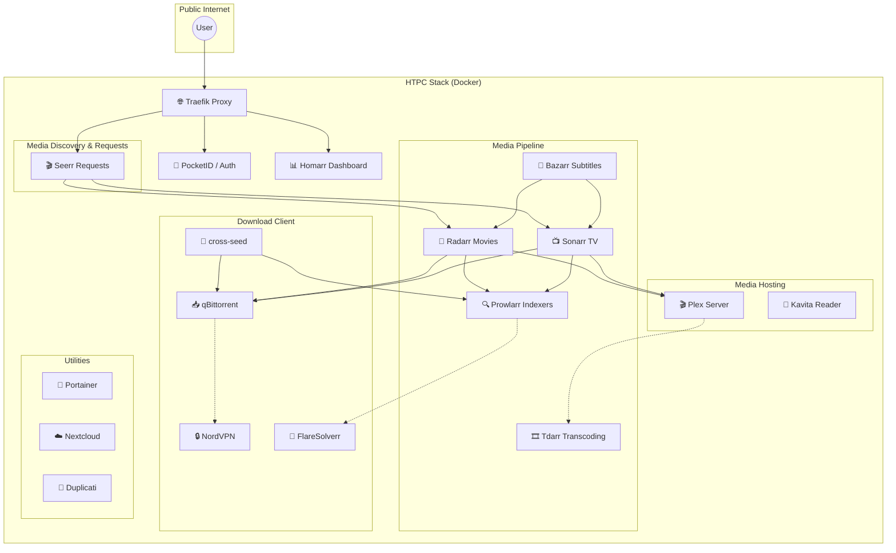


| Service | Purpose | Port | URL |
|---------|---------|------|-----|
| 🌐 Traefik | Reverse Proxy | 80, 443 | `traefik.${SERVERNAME}` |
| 🔐 Forward Auth | SSO Authentication | - | `auth.${SERVERNAME}` |
| 📊 Homarr | Dashboard | - | `homarr.${SERVERNAME}` |
| 🎬 Seerr | Media Requests | - | `seerr.${SERVERNAME}` |
| 🎥 Radarr | Movie Management | - | `radarr.${SERVERNAME}` |
| 📺 Sonarr | TV Management | - | `sonarr.${SERVERNAME}` |
| 🔍 Prowlarr | Indexer Manager | - | `prowlarr.${SERVERNAME}` |
| 📝 Bazarr | Subtitles | - | `bazarr.${SERVERNAME}` |
| 🔒 NordVPN | VPN Tunnel | - | (internal) |
| 📥 qBittorrent | Download Client | - | `qbittorrent.${SERVERNAME}` |
| 🔁 cross-seed | Cross-seed Automation | 2468 | `crossseed.${SERVERNAME}` |
| 🎬 Plex | Media Server | 32400 | `http://server-ip:32400/web` |
| 🎞️ Tdarr | Transcoding | - | `tdarr.${SERVERNAME}` |
| 📖 Kavita | Ebook/Comic Reader | - | `kavita.${SERVERNAME}` |
| �� Swaparr | Stalled Manager | - | Background |
| ☁️ Nextcloud | File Sync | - | `nextcloud.${SERVERNAME}` |
| 💾 Duplicati | Backups | - | `duplicati.${SERVERNAME}` |
| 🐳 Portainer | Container Manager | - | `portainer.${SERVERNAME}` |

---

## 🌐 Traefik (Reverse Proxy)

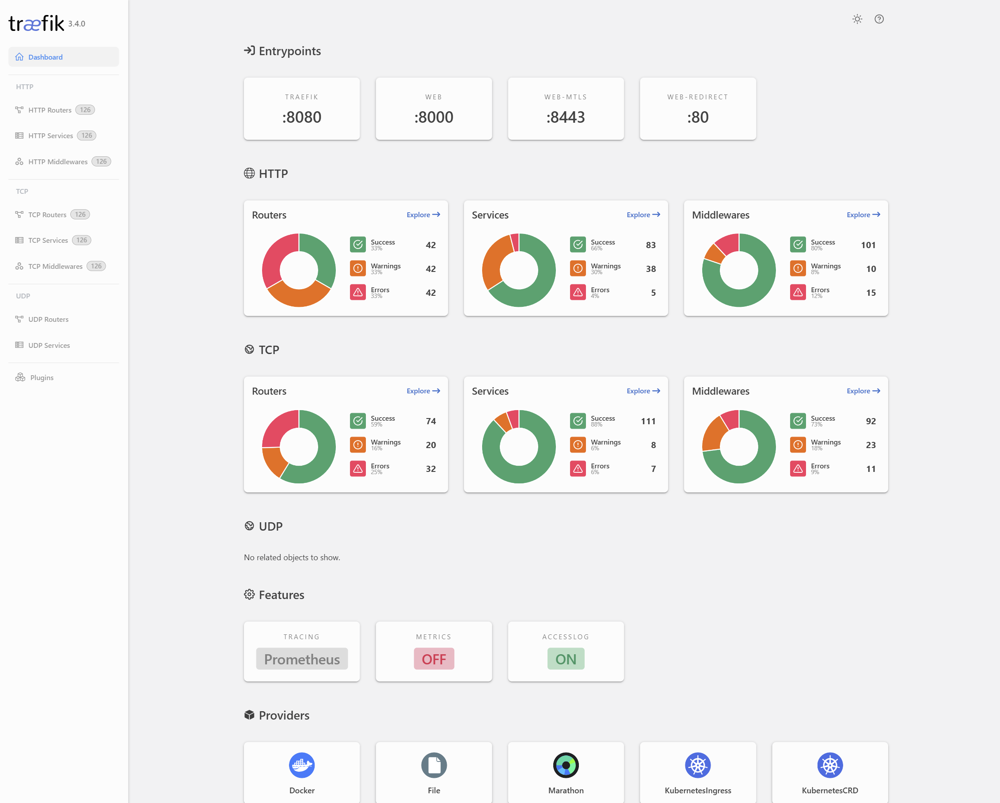
*The Traefik dashboard provides real-time visibility into your routing and service health.*

**Container**: `traefik`  
**Ports**: 80 (HTTP), 443 (HTTPS)  
**Web UI**: `https://traefik.${SERVERNAME}`

### 📖 About
Traefik automatically routes traffic to services and handles HTTPS certificates via Let's Encrypt.

### ⚙️ Configuration
- Certificates: Stored in `./letsencrypt/acme.json`
- Dashboard: Protected by forward-auth
- Automatic service discovery via Docker labels

### 🔧 Key Features
- ✅ Automatic HTTPS certificates
- ✅ HTTP to HTTPS redirect
- ✅ Service discovery
- ✅ Load balancing
- ✅ Security headers

---

## 🔐 Traefik Forward Auth

**Container**: `traefik-forward-auth`  
**Purpose**: Centralized SSO authentication

### 📖 About
Provides OAuth2 authentication for all Traefik-protected services.

### 🔧 Setup Steps

1. **Choose OAuth Provider** (Google, GitHub, etc.)

2. **Create OAuth App**:
   - **Google**: [Console](https://console.cloud.google.com/)
   - **GitHub**: Settings → Developer → OAuth Apps
   
3. **Set Callback URL**: `https://auth.${SERVERNAME}/_oauth`

4. **Configure Environment** (in docker-compose.yml):
```yaml
environment:
  - PROVIDERS_GOOGLE_CLIENT_ID=your_client_id
  - PROVIDERS_GOOGLE_CLIENT_SECRET=your_secret
  - SECRET=generate_random_secret_here
  - AUTH_HOST=auth.${SERVERNAME}
  - COOKIE_DOMAIN=${SERVERNAME}
```

5. **Restart Service**:
```bash
docker compose up -d traefik-forward-auth
```

---

## 🪪 PocketID


*Self-hosted identity provider and authentication gateway for your stack.*

**Container**: `pocketid`  
**Web UI**: `https://auth.${SERVERNAME}`

### 📖 About
Self-hosted identity provider for complete control over authentication.

### 🔧 Setup
1. Access web UI
2. Create admin account
3. Configure services to use PocketID
4. Add users/groups

---

## 📊 Homarr (Dashboard)

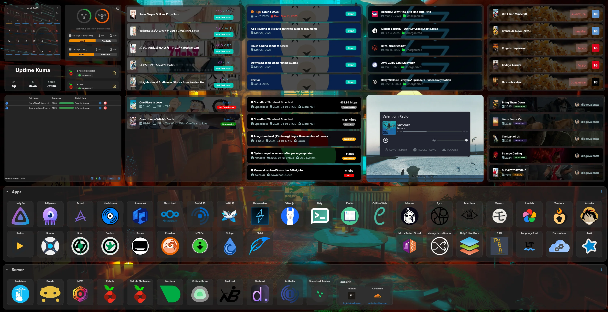
*A sleek, customizable dashboard to quickly access and monitor all your services.*

**Container**: `homarr`  
**Web UI**: `https://homarr.${SERVERNAME}`

### 📖 About
Beautiful, customizable dashboard for all your services with integrations and monitoring.

### 🔧 Setup Steps

1. **Access Dashboard**: Navigate to URL
2. **Add Services**: 
   - Click "+" to add service tiles
   - Configure icons, URLs, and descriptions
3. **Add Widgets**:
   - Weather
   - Calendar
   - Media requests
   - System stats
4. **Configure Integrations**:
   - Radarr/Sonarr API keys
   - Plex token
   - Download client stats

### 💡 Recommended Widgets
- 📊 System resources
- 🎬 Recent media additions
- 📥 Download queue
- 🌡️ Weather
- 📅 Calendar

---

## 🎬 Seerr (Media Requests)

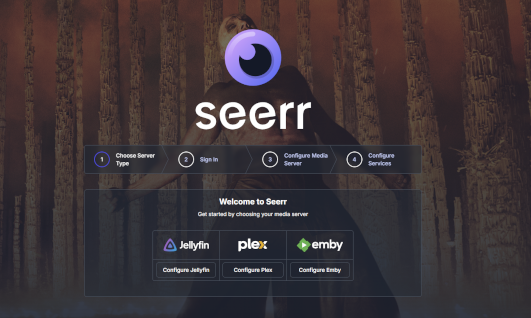
*Beautiful request and discovery platform for Plex.*

**Container**: `seerr`  
**Web UI**: `https://seerr.${SERVERNAME}`

### 📖 About
Beautiful request and discovery platform for Plex. Perfect for letting family/friends request content.

### 🔧 Initial Setup

#### Step 1: Connect to Plex
1. Access Seerr web UI
2. Click "Sign in with Plex"
3. Authorize Seerr

#### Step 2: Configure Plex Libraries
1. Select your Plex server
2. Enable libraries to sync (Movies, TV Shows)
3. Start initial sync (may take a while)

#### Step 3: Add Radarr
1. Settings → Services → Radarr
2. Add server:
   - **Server Name**: Radarr
   - **Hostname/IP**: `radarr` (container name)
   - **Port**: `7878`
   - **API Key**: Get from Radarr → Settings → General → Security
   - **Quality Profile**: Select default (HD-1080p recommended)
   - **Root Folder**: `/movies`
3. Test and Save

#### Step 4: Add Sonarr
1. Settings → Services → Sonarr
2. Add server:
   - **Server Name**: Sonarr
   - **Hostname/IP**: `sonarr`
   - **Port**: `8989`
   - **API Key**: From Sonarr settings
   - **Quality Profile**: Select default
   - **Root Folder**: `/tv`
3. Test and Save

#### Step 5: Configure Users & Permissions
1. Settings → Users
2. Import Plex users
3. Set permissions:
   - **Admin**: Full access
   - **User**: Request and view status
   - **Quotas**: Optional limits per user

#### Step 6: Notifications (Optional)
- Email
- Discord
- Telegram
- Slack
- Webhook

### 💡 Usage
- Users can browse and request content
- Automatic approval or admin review
- Status tracking (pending → downloading → available)
- Notifications when content is ready

---

## 🔍 Prowlarr (Indexer Manager)

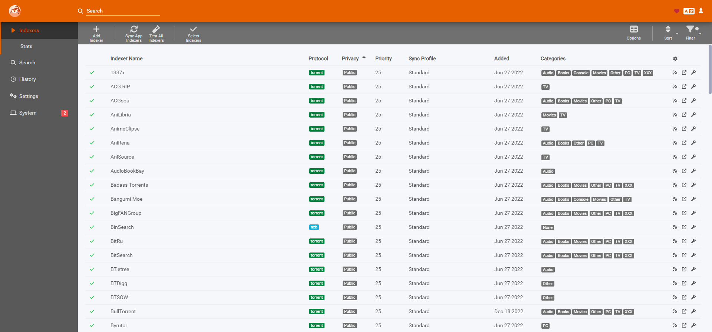
*Indexer manager for integrating Torrent and Usenet search.*

**Container**: `prowlarr`  
**Web UI**: `https://prowlarr.${SERVERNAME}`

### 📖 About
Centralized indexer management. Add indexers once, sync to all *arr apps automatically.

### 🔧 Setup Steps

#### Step 1: Add Indexers
1. Indexers → Add Indexer
2. Search for your trackers/indexers
3. Common public indexers:
   - RARBG (if available)
   - 1337x
   - The Pirate Bay
   - YTS
4. For private trackers:
   - Enter credentials
   - Configure rate limits

#### Step 2: Add FlareSolverr (for Cloudflare-protected sites)
1. Settings → Indexers
2. Enable FlareSolverr
3. URL: `http://flaresolverr:8191`

#### Step 3: Connect Radarr
1. Settings → Apps → Add Application
2. Select Radarr
3. Configure:
   - **Prowlarr Server**: `http://prowlarr:9696`
   - **Radarr Server**: `http://radarr:7878`
   - **API Key**: From Radarr settings
4. Test and Save

#### Step 4: Connect Sonarr
1. Add Application → Sonarr
2. Configure:
   - **Prowlarr Server**: `http://prowlarr:9696`
   - **Sonarr Server**: `http://sonarr:8989`
   - **API Key**: From Sonarr settings
3. Test and Save

#### Step 5: Sync Indexers
1. Settings → Apps
2. Click "Full Sync" for each app
3. Verify indexers appear in Radarr/Sonarr

### 💡 Benefits
- ✅ Add indexers once, use everywhere
- ✅ Centralized management
- ✅ Automatic category mapping
- ✅ Built-in health checks

---

## 🎥 Radarr (Movie Management)

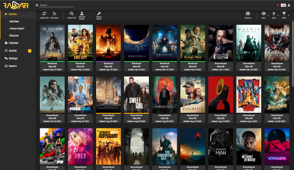
*Automated movie download and collection management.*

**Container**: `radarr`  
**Web UI**: `https://radarr.${SERVERNAME}`

### 📖 About
Automated movie downloading, renaming, and organization.

### 🔧 Setup Steps

#### Step 1: Add Download Client (qBittorrent)
1. Settings → Download Clients → Add → qBittorrent
2. Configure:
   - **Name**: qBittorrent
   - **Host**: `qbittorrent` (container name)
   - **Port**: `8112`
   - **Password**: `qbittorrent` (change in qBittorrent first!)
   - **Category**: `radarr-movies`
3. Test and Save

#### Step 2: Configure Root Folder
1. Settings → Media Management → Root Folders
2. Add root folder: `/movies`

#### Step 3: Quality Profiles
1. Settings → Profiles
2. Review/edit quality profiles:
   - **Any**: Grabs first available
   - **HD-1080p**: Recommended for most
   - **Ultra-HD**: For 4K content (large files!)

#### Step 4: File Naming
1. Settings → Media Management
2. Enable "Rename Movies"
3. Recommended format: `{Movie Title} ({Release Year}) [imdbid-{ImdbId}]`

#### Step 5: Add a Movie (Test)
1. Movies → Add New
2. Search for a movie
3. Select quality profile
4. Monitor: Yes
5. Add Movie

### 💡 Workflow
1. Movie added → searches indexers
2. Finds match → sends to qBittorrent
3. Download completes → moves to `/movies`
4. Renames and organizes automatically
5. Updates Plex library

---

## 📺 Sonarr (TV Show Management)

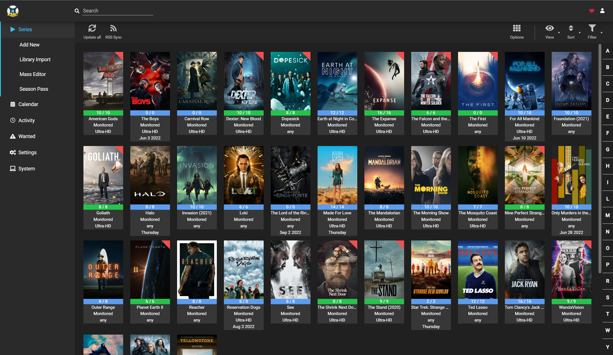
*Automated TV series download and collection management.*

**Container**: `sonarr`  
**Web UI**: `https://sonarr.${SERVERNAME}`

### 📖 About
Automated TV show downloading with episode tracking and season management.

### 🔧 Setup Steps

#### Step 1: Add Download Client (qBittorrent)
1. Settings → Download Clients → Add → qBittorrent
2. Configure:
   - **Name**: qBittorrent
   - **Host**: `qbittorrent`
   - **Port**: `8112`
   - **Password**: (qBittorrent password)
   - **Category**: `sonarr-tv`
3. Test and Save

#### Step 2: Configure Root Folder
1. Settings → Media Management → Root Folders
2. Add root folder: `/tv`

#### Step 3: Episode Naming
1. Settings → Media Management
2. Enable "Rename Episodes"
3. Format:
   - **Standard**: `{Series Title} - S{season:00}E{episode:00} - {Episode Title}`
   - **Daily**: `{Series Title} - {Air-Date} - {Episode Title}`
   - **Anime**: `{Series Title} - {absolute:000} - {Episode Title}`

#### Step 4: Quality Profiles
1. Settings → Profiles
2. Common profiles:
   - **HD-720p/1080p**: Good balance
   - **Any**: Fastest availability

#### Step 5: Add a Show (Test)
1. Series → Add New
2. Search for a show
3. Configure:
   - **Monitor**: All episodes / Future episodes / First season
   - **Quality Profile**: Select appropriate
   - **Season Folder**: Yes
4. Add Series

### 💡 Monitoring Options
- **All**: Downloads all episodes (including old)
- **Future**: Only new episodes from now on
- **Missing**: Searches for missing episodes
- **First Season**: Test before committing to full series

---

## 📝 Bazarr (Subtitles)

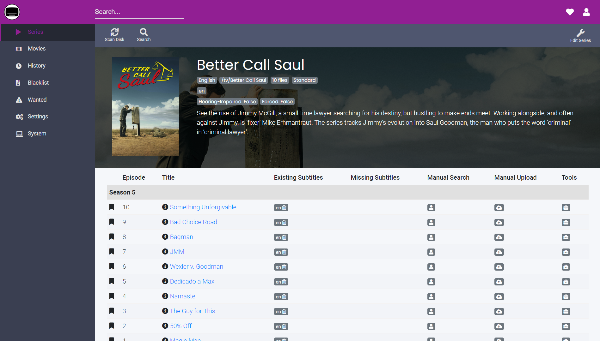
*Companion application to download missing subtitles.*

**Container**: `bazarr`  
**Web UI**: `https://bazarr.${SERVERNAME}`

### 📖 About
Automatic subtitle downloading for your media in 40+ languages.

### 🔧 Setup Steps

#### Step 1: Connect Radarr
1. Settings → Radarr
2. Enable and configure:
   - **Address**: `http://radarr:7878`
   - **API Key**: From Radarr settings
3. Test and Save

#### Step 2: Connect Sonarr
1. Settings → Sonarr
2. Enable and configure:
   - **Address**: `http://sonarr:8989`
   - **API Key**: From Sonarr settings
3. Test and Save

#### Step 3: Add Subtitle Providers
1. Settings → Providers
2. Recommended providers:
   - **OpenSubtitles**: Free account required
   - **Subscene**: No account needed
   - **Addic7ed**: Good for TV shows
3. For each provider:
   - Enable
   - Add credentials if required
   - Set language priority

#### Step 4: Language Configuration
1. Settings → Languages
2. Languages Filter:
   - Add languages you want (e.g., English, French)
3. Default Settings:
   - **Single Language**: If you only want one language
   - **Default Enabled**: For new movies/shows

#### Step 5: Automatic Search
1. Settings → Scheduler
2. Configure:
   - **Search Subtitles**: Every 6 hours recommended
   - **Upgrade Subtitles**: Weekly

### 💡 Features
- ✅ Automatic subtitle search
- ✅ Multi-language support
- ✅ Hearing impaired subtitles
- ✅ Manual search option
- ✅ Subtitle upgrade (better quality)

---

## 🔒 NordVPN

**Container**: `nordvpn`  
**Purpose**: VPN tunnel for secure downloading

### 📖 About
Routes qBittorrent traffic through NordVPN to protect privacy.

### ⚙️ Configuration

Set in `.env`:
```bash
VPN_USER=your_email@example.com
VPN_PWD=your_password
VPN_COUNTRY=US
NORDVPN_PROTOCOL=nordlynx  # fastest
```

### 🔧 Country Codes
- `US` - United States
- `UK` - United Kingdom
- `CH` - Switzerland
- `NL` - Netherlands
- Check [NordVPN docs](https://nordvpn.com/servers/) for full list

### 🧪 Test VPN Connection
```bash
# Check if VPN is connected
docker compose logs nordvpn

# Test external IP (should be VPN IP, not your real IP)
docker exec nordvpn curl https://ipinfo.io
```

---

## 📥 qBittorrent (Download Client)

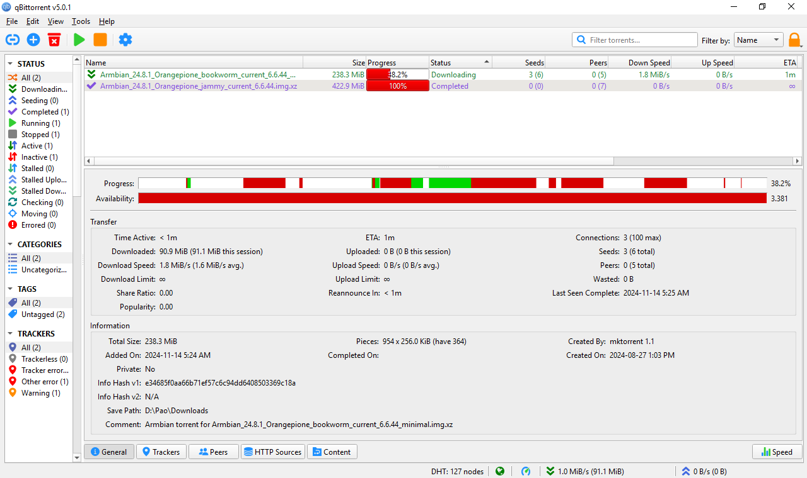
*BitTorrent client routing all traffic through NordVPN.*

**Container**: `qbittorrent`  
**Web UI**: `https://qbittorrent.${SERVERNAME}`  
**Default Password**: `qbittorrent` ⚠️ **CHANGE IMMEDIATELY!**

### 📖 About
BitTorrent client running behind NordVPN for secure downloads.

### 🔧 Setup Steps

#### Step 1: Change Default Password
1. Login with password: `qbittorrent`
2. Preferences → Interface → Password
3. Set a strong password

#### Step 2: Configure Paths
1. Preferences → Downloads
2. Set:
   - **Download to**: `/downloads/incomplete`
   - **Move completed to**: `/downloads/complete`
   - **Auto-managed**: Yes

#### Step 3: Enable Labels Plugin
1. Preferences → Plugins
2. Enable "Label" plugin
3. This allows Radarr/Sonarr to categorize downloads

#### Step 4: Create Labels
1. Right-click in main window → Label → Add
2. Create labels:
   - `radarr-movies`
   - `sonarr-tv`
3. For each label → Options:
   - **Move Completed To**: 
     - `/downloads/complete/movies` (for radarr)
     - `/downloads/complete/tv` (for sonarr)

### 🧪 Test Download
Add a Linux ISO torrent to verify:
- Download starts
- VPN is working (check IP)
- Moves to complete folder

---

## 🔁 cross-seed (Cross-seeding)

- **Container**: `cross-seed`
- **API**: `https://crossseed.${SERVERNAME}`
- **Active configuration**: `./config.js`

### 📖 About

cross-seed searches configured indexers for releases that match existing
qBittorrent data. It injects valid matches and reuses the existing media data.

### 🔧 Setup Steps

1. Copy the tracked example:
   ```bash
   cp config.example.js config.js
   ```
2. Replace every placeholder in `config.js`.
3. Add one Prowlarr Torznab URL for each indexer that cross-seed can search.
4. URL-encode the qBittorrent username and password in `torrentClients`.
5. Create `${CONFIG}/cross-seed` and `${ROOT}/downloads/cross-seed-links` on the host.
6. Give both directories to the user and group from `PUID` and `PGID`.
7. Start the service:
   ```bash
   docker compose up -d cross-seed
   docker compose logs -f cross-seed
   ```

The Compose file mounts `config.js` at `/config/config.js` as a read-only file.
It stores the database and logs in `${CONFIG}/cross-seed`. It mounts downloads
at `/downloads`, which is the same container path that qBittorrent uses.

Get the generated API key after startup:

```bash
docker compose exec cross-seed cross-seed api-key
```

Do not add API keys or passwords to `config.example.js`. Git ignores the active
`config.js` file. See the
[cross-seed getting-started guide](https://www.cross-seed.org/docs/basics/getting-started)
for option details.

---

## 🔧 FlareSolverr

**Container**: `flaresolverr`  
**Port**: 8191 (internal)

### 📖 About
Proxy server that bypasses Cloudflare protection for indexers.

### ⚙️ Usage
Automatically used by Prowlarr when enabled. No manual configuration needed.

---

## 🎬 Plex Media Server

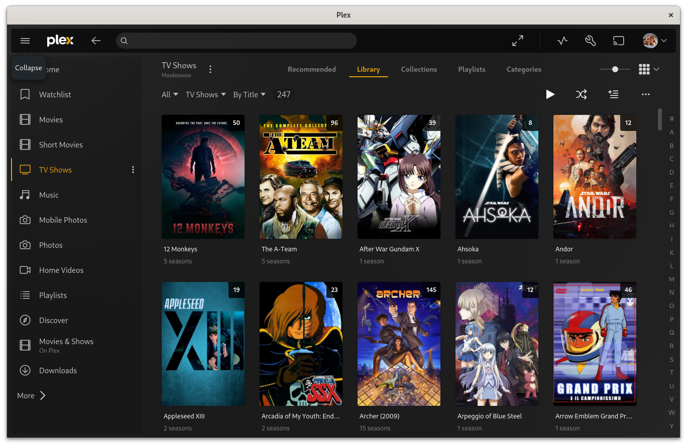
*Your personal Netflix - stream media to any device, anywhere.*

**Container**: `plex-server`  
**Web UI**: `http://<your-server-ip>:32400/web`

### 📖 About
Your personal Netflix - stream media to any device, anywhere.

### 🔧 Setup Steps

#### Step 1: Claim Server
1. Access web UI
2. Sign in with Plex account
3. Follow setup wizard

#### Step 2: Add Movie Library
1. Settings → Libraries → Add Library
2. Type: Movies
3. Add folder: `/media/movies`
4. Scanner: Plex Movie
5. Agent: Plex Movie

#### Step 3: Add TV Show Library
1. Add Library → TV Shows
2. Add folder: `/media/tv`
3. Scanner: Plex TV Series
4. Agent: Plex Series

#### Step 4: Configure Transcoding (Optional)
If you have an NVIDIA GPU:
1. Settings → Transcoder
2. Transcoder quality: Automatic
3. Enable: Use hardware acceleration when available
4. Hardware transcoding device: Select your GPU

#### Step 5: Remote Access
1. Settings → Remote Access
2. Enable "Manually specify public port"
3. Configure port forwarding on your router: `32400`

### 🎮 Hardware Transcoding (NVIDIA)
Requires:
- NVIDIA GPU in host
- NVIDIA drivers installed
- `nvidia-docker-runtime` configured

Check GPU access:
```bash
docker exec plex-server nvidia-smi
```

### 💡 Plex Pass Features
- Hardware transcoding (multiple streams)
- Mobile sync
- Live TV & DVR
- Skip intro detection
- 4K streaming

---

## 🔄 Plex Trakt Sync

**Containers**: `scheduler`, `plextraktsync`

### 📖 About
Syncs your Plex watch history with Trakt.tv for tracking across platforms.

### 🔧 Setup Steps

1. **Create Trakt API App**:
   - Go to [Trakt API Apps](https://trakt.tv/oauth/applications/new)
   - Create application
   - Note Client ID and Secret

2. **Configure Authentication**:
```bash
docker exec -it plextraktsync bash
plextraktsync
# Follow authentication prompts
```

3. **Schedule Sync**:
   - Configured via `scheduler` container
   - Default: Every 6 hours

---

## 🎞️ Tdarr (Transcoding)

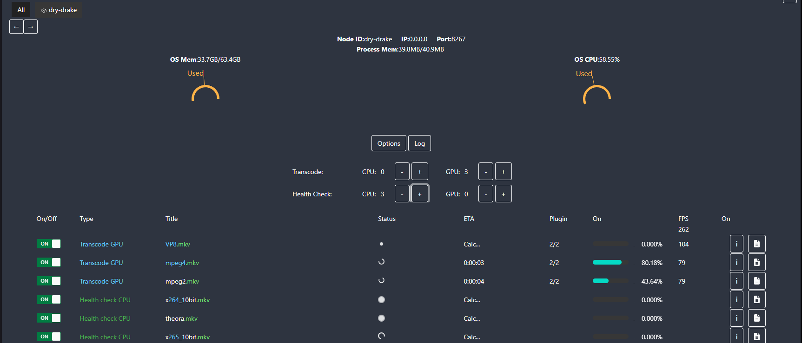
*Distributed audio and video transcoding and library management.*

**Container**: `tdarr`  
**Web UI**: `https://tdarr.${SERVERNAME}`

### 📖 About
Distributed transcoding system for optimizing your media library.

### 🔧 Use Cases
- Reduce file sizes (H.264 → H.265)
- Convert audio formats
- Remove unwanted subtitle tracks
- Standardize video quality
- Save storage space

### 🚀 Setup Steps

1. **Add Library**:
   - Add `/media/movies` and/or `/media/tv`
   
2. **Choose Plugins**:
   - Transcode to H.265 (HEVC)
   - Audio normalization
   - Subtitle extraction

3. **Configure Workers**:
   - CPU workers for software transcoding
   - GPU workers for hardware acceleration (NVIDIA)

### ⚠️ Warning
Transcoding is **CPU/GPU intensive** and can take days for large libraries. Start with a test folder!

---

## 📖 Kavita (Ebook/Comic Server)

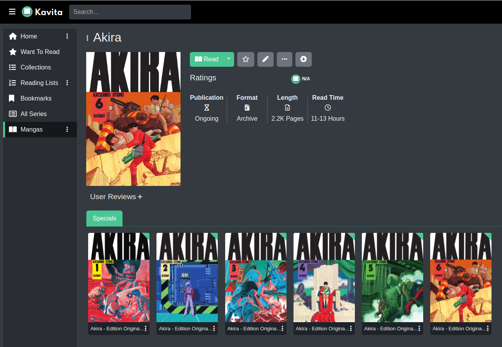
*Digital library for ebooks, comics, manga, and PDFs with a beautiful web reader.*

**Container**: `kavita`  
**Web UI**: `https://kavita.${SERVERNAME}`

### 📖 About
Digital library for ebooks, comics, manga, and PDFs with a beautiful web reader.

### 🔧 Setup Steps

1. **Create Account**: First user is admin
2. **Add Library**:
   - Settings → Libraries → Add
   - Type: Comics / Books / Manga
   - Path: `/books`
3. **Scan Library**: Trigger initial scan
4. **Configure OPDS** (for reader apps):
   - Enable OPDS feed
   - Use with apps like Chunky (iOS), Tachiyomi (Android)

### 📚 Supported Formats
- **Comics**: CBZ, CBR, CB7, CBT
- **Ebooks**: EPUB, PDF
- **Images**: ZIP, RAR with images

---

## ☁️ Nextcloud

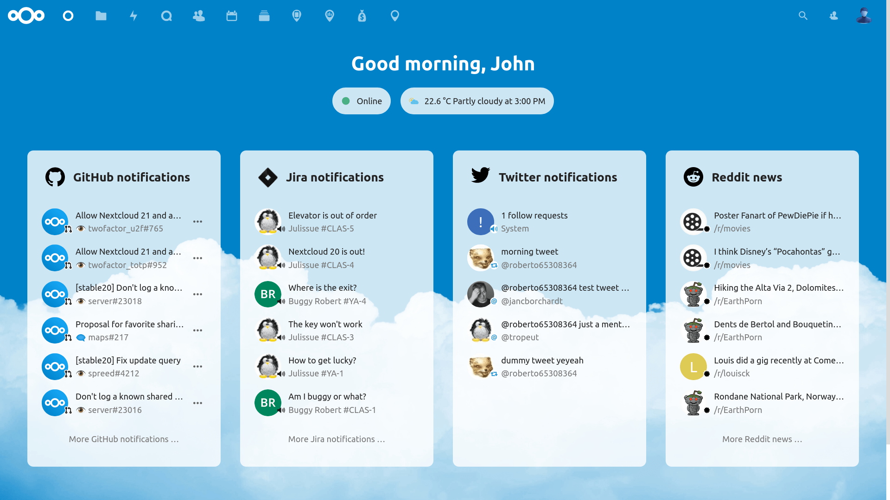
*Self-hosted file sync and collaboration - your own Dropbox/Google Drive.*

**Container**: `nextcloud`  
**Web UI**: `https://nextcloud.${SERVERNAME}`

### 📖 About
Self-hosted file sync and collaboration - your own Dropbox/Google Drive.

### 🔧 Setup Steps

1. **Complete Setup Wizard**:
   - Create admin account
   - Connect to MariaDB database:
     - **User**: `nextcloud` (from .env)
     - **Password**: `${MYSQL_PASSWORD}`
     - **Database**: `nextcloud`
     - **Host**: `database:5432`

2. **Install Recommended Apps**:
   - Calendar
   - Contacts
   - Notes
   - Deck (kanban)
   - Talk (chat/video)

3. **Configure Cron**:
   - Administration → Basic settings
   - Background jobs → Cron
   - Already configured in docker-compose

4. **Desktop/Mobile Sync**:
   - Download Nextcloud client for your devices
   - Connect using your URL and credentials

---

## 💾 Duplicati (Backups)

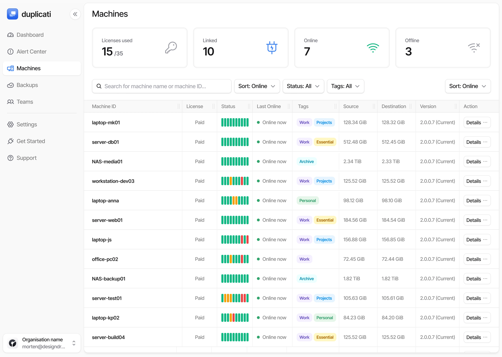
*Securely stores encrypted, incremental, compressed remote backups.*

**Container**: `duplicati`  
**Web UI**: `https://duplicati.${SERVERNAME}`

### 📖 About
Encrypted backup solution supporting cloud storage providers.

### 🔧 What to Backup

**Essential** (small, critical):
- `/config` - All service configurations
- Docker compose files
- `.env` file (store securely!)

**Optional** (large):
- Plex metadata
- Download history
- Watch status

**Don't Backup**:
- Media files (too large, easily re-acquired)
- Incomplete downloads

### 🚀 Setup Steps

1. **Add Backup Job**:
   - Home → Add backup

2. **Choose Destination**:
   - S3/B2/Google Drive/FTP/etc.
   - Configure credentials

3. **Select Source**:
   - `/config`

4. **Configure Schedule**:
   - Daily at 3 AM recommended

5. **Set Encryption**:
   - AES-256
   - **Save passphrase securely!**

---

## 🐳 Portainer (Container Management)

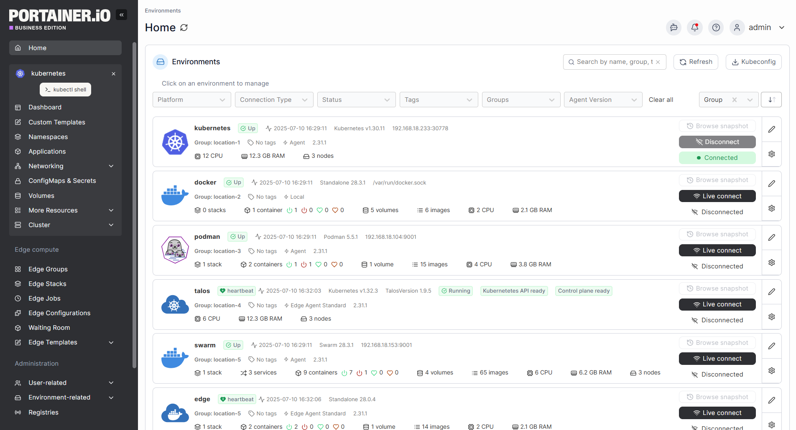
*Powerful container management platform.*

**Container**: `portainer`  
**Web UI**: `https://portainer.${SERVERNAME}`

### 📖 About
Visual Docker management interface for monitoring and controlling containers.

### 💡 Features
- 📊 Container stats and logs
- 🎛️ Start/stop/restart containers
- 📝 Edit container configs
- 🖥️ Console access
- 📈 Resource monitoring

---

## 🔄 Watchtower (Auto-Updates)

**Container**: `watchtower`

### 📖 About
Automatically updates Docker containers when new images are available.

### ⚙️ Configuration
Only updates containers with label:
```yaml
labels:
  - com.centurylinklabs.watchtower.enable=true
```

Default schedule: Daily at 4 AM

---

## 💾 TrueNAS Integration

**Container**: `truenas`

Custom container for TrueNAS API integration (if you use TrueNAS for storage).

---

## 🔗 Service Integration Guide

### 🎬 Complete Media Pipeline Setup

Follow this order for seamless integration:

#### 1️⃣ VPN & Download Client (15 min)
```
NordVPN → qBittorrent
```
1. Verify VPN is connected
2. Setup qBittorrent labels for movies/tv
3. Change default password
4. Test with a legal torrent

#### 2️⃣ Indexer Management (10 min)
```
FlareSolverr → Prowlarr
```
1. Add FlareSolverr to Prowlarr
2. Add 3-5 indexers (public or private)
3. Test each indexer

#### 3️⃣ Media Management (20 min)
```
Prowlarr → Radarr → qBittorrent
Prowlarr → Sonarr → qBittorrent
```

**Radarr**:
1. Add qBittorrent as download client
2. Add `/movies` root folder
3. Connect Prowlarr app
4. Sync indexers
5. Add a test movie

**Sonarr**:
1. Add qBittorrent as download client
2. Add `/tv` root folder
3. Connect Prowlarr app
4. Sync indexers
5. Add a test TV show

#### 4️⃣ Subtitle Automation (10 min)
```
Radarr/Sonarr → Bazarr → OpenSubtitles
```
1. Connect Bazarr to Radarr
2. Connect Bazarr to Sonarr
3. Add subtitle providers
4. Configure languages
5. Enable automatic search

#### 5️⃣ Media Server (15 min)
```
Radarr/Sonarr → Plex
```
1. Claim Plex server
2. Add movie library (`/media/movies`)
3. Add TV library (`/media/tv`)
4. Configure transcoding
5. Setup remote access

#### 6️⃣ Request System (10 min)
```
Plex → Seerr → Radarr/Sonarr
```
1. Sign in to Seerr with Plex
2. Sync Plex libraries
3. Connect Radarr (with API key)
4. Connect Sonarr (with API key)
5. Configure user permissions

#### 7️⃣ Dashboard (5 min)
```
All Services → Homarr
```
1. Add service tiles
2. Configure widgets
3. Add API integrations

### 🎯 Test the Complete Flow

1. **Request**: Use Seerr to request a movie
2. **Watch**: It should:
   - ✅ Appear in Radarr
   - ✅ Search indexers via Prowlarr
   - ✅ Send to qBittorrent (through VPN)
   - ✅ Download complete
   - ✅ Move to `/movies` folder
   - ✅ Get renamed by Radarr
   - ✅ Fetch subtitles via Bazarr
   - ✅ Appear in Plex
   - ✅ Mark as "Available" in Seerr

🎉 **If all steps work**: Your media pipeline is fully automated!

---

## ⚙️ Configuration

### 🌐 Network Configuration

This stack uses a custom bridge network `npm_proxy` with static IPs:

```yaml
networks:
  npm_proxy:
    name: npm_proxy
    driver: bridge
    ipam:
      config:
        - subnet: 192.168.89.0/24
```

Services are assigned static IPs (e.g., `192.168.89.100-120`) for predictable networking.

### 🏷️ Traefik Labels

Services are exposed via Traefik using labels:

```yaml
labels:
  - "traefik.enable=true"
  - "traefik.http.routers.SERVICE.rule=Host(`SERVICE.${SERVERNAME}`)"
  - "traefik.http.routers.SERVICE.entrypoints=websecure"
  - "traefik.http.routers.SERVICE.tls=true"
  - "traefik.http.routers.SERVICE.tls.certresolver=letsencrypt"
  - "traefik.http.services.SERVICE.loadbalancer.server.port=PORT"
```

### 🔐 Authentication Middleware

Protect services with different auth levels:

```yaml
# Admin only
- "traefik.http.routers.SERVICE.middlewares=auth-admin"

# Any authenticated user
- "traefik.http.routers.SERVICE.middlewares=auth-user"

# No auth (service handles it)
- "traefik.http.routers.SERVICE.middlewares=sanitize-headers"
```

---

## 💻 Useful Commands

### 🐳 Docker Compose

```bash
# Start all services
docker compose up -d

# Start specific service
docker compose up -d SERVICE_NAME

# Rebuild and start (use after code/image changes)
docker compose up -d --build SERVICE_NAME

# Stop all services
docker compose down

# Stop but keep data
docker compose stop

# Restart service
docker compose restart SERVICE_NAME

# View logs (live)
docker compose logs -f SERVICE_NAME

# View last 100 lines
docker compose logs --tail 100 SERVICE_NAME

# View status
docker compose ps

# Validate config (catches errors)
docker compose config

# Remove stopped containers
docker compose rm
```

---

### 📦 Container Management

```bash
# List all containers
docker ps -a

# Stop all running containers
docker stop $(docker ps -q)

# Remove all stopped containers
docker rm $(docker ps -a -q)

# Remove all unused images
docker image prune -a

# Remove all unused volumes (⚠️ deletes data!)
docker volume prune

# Remove all unused networks
docker network prune

# Complete cleanup (⚠️ dangerous!)
docker system prune -a --volumes
```

---

### 📊 Logs & Debugging

```bash
# Live logs with timestamps
docker logs --tail 50 --follow --timestamps CONTAINER_NAME

# Get shell in container
docker exec -it CONTAINER_NAME bash

# Run single command
docker exec CONTAINER_NAME ls -la /config

# Check resource usage
docker stats

# Inspect container details
docker inspect CONTAINER_NAME

# View container processes
docker top CONTAINER_NAME
```

---

### 💾 Disk Usage

```bash
# Docker disk usage breakdown
docker system df -v

# Analyze directory sizes (interactive)
ncdu /mnt/media

# Quick directory size
du -sh /mnt/media/*

# Check disk space
df -h
```

---

### 🌐 Network Debugging

```bash
# Test VPN connection
docker exec nordvpn curl https://ipinfo.io

# Should show VPN IP, not your real IP

# Check container network
docker network inspect npm_proxy

# Test Traefik routing
curl -H "Host: radarr.yourdomain.com" http://localhost

# DNS resolution inside container
docker exec radarr nslookup google.com

# Check open ports
netstat -tulpn | grep LISTEN
```

---

### 🔍 Service-Specific Commands

```bash
# Radarr: Trigger search for all missing movies
# (via API - get API key from Radarr settings)
curl -X POST "http://localhost:7878/api/v3/command" \
  -H "X-Api-Key: YOUR_API_KEY" \
  -H "Content-Type: application/json" \
  -d '{"name":"missingMoviesSearch"}'

# Sonarr: Similar search
curl -X POST "http://localhost:8989/api/v3/command" \
  -H "X-Api-Key: YOUR_API_KEY" \
  -H "Content-Type: application/json" \
  -d '{"name":"missingEpisodeSearch"}'

# Plex: Scan library
docker exec plex-server \
  '/usr/lib/plexmediaserver/Plex Media Scanner' --scan --refresh \
  --section 1  # Section ID from library settings

# qBittorrent: List active torrents
docker exec qbittorrent qbittorrent-console "info"
```

---

## 🐛 Troubleshooting

### 🚨 Traefik Not Getting Certificates

**Symptoms**:
- HTTPS not working
- Browser shows "insecure connection"
- Services accessible via IP but not domain

**Diagnosis**:
```bash
# Check Traefik logs
docker compose logs traefik | grep -i error

# Verify DNS
nslookup yourdomain.com

# Check ports are open
nc -zv yourdomain.com 80
nc -zv yourdomain.com 443
```

**Solutions**:

1. **Verify DNS**:
   - Domain must point to your server IP
   - Wait for DNS propagation (up to 48h)

2. **Check Firewall**:
   ```bash
   sudo ufw allow 80/tcp
   sudo ufw allow 443/tcp
   ```

3. **Force Certificate Renewal**:
   ```bash
   # Stop Traefik
   docker compose stop traefik
   
   # Delete certificates
   rm -rf ./letsencrypt/acme.json
   
   # Restart
   docker compose up -d traefik
   
   # Watch logs
   docker compose logs -f traefik
   ```

---

### 🌐 Service Not Accessible via Traefik

**Symptoms**:
- 404 or 502 error
- "Service Unavailable"

**Diagnosis**:
```bash
# Check service is running
docker compose ps SERVICE_NAME

# Check logs
docker compose logs SERVICE_NAME

# Inspect Traefik routes
docker compose exec traefik cat /etc/traefik/traefik.yml

# Check network
docker network inspect npm_proxy
```

**Solutions**:

1. **Verify Labels**:
   - Check docker-compose.yml
   - Ensure service has correct Traefik labels
   - Port must match service's internal port

2. **Check Network**:
   ```bash
   # Ensure service is on npm_proxy network
   docker inspect SERVICE_NAME | grep -A 10 Networks
   ```

3. **Restart Service**:
   ```bash
   docker compose restart SERVICE_NAME traefik
   ```

---

### 🔒 VPN Not Working / qBittorrent No Internet

**Symptoms**:
- qBittorrent can't download torrents
- "No incoming connections" warning
- Downloads stuck at 0%

**Diagnosis**:
```bash
# Check VPN status
docker compose logs nordvpn

# Test VPN IP
docker exec nordvpn curl https://ipinfo.io

# Check qBittorrent can reach internet
docker exec qbittorrent ping -c 3 8.8.8.8
```

**Solutions**:

1. **Verify VPN Credentials**:
   - Check `.env` file
   - Ensure `VPN_USER` and `VPN_PWD` are correct

2. **Restart VPN**:
   ```bash
   docker compose restart nordvpn
   
   # Wait 30 seconds
   
   docker compose restart qbittorrent
   ```

3. **Change VPN Server**:
   - Edit `.env`
   - Try different country: `VPN_COUNTRY=CH`
   - Restart services

4. **Check VPN Protocol**:
   - Try `nordlynx` (fastest) or `openvpn_tcp` (most compatible)

---

### 📁 Permission Issues

**Symptoms**:
- "Permission denied" errors
- Services can't write files
- Libraries not updating

**Diagnosis**:
```bash
# Check file ownership
ls -la ${ROOT}
ls -la ${CONFIG}

# Check PUID/PGID in .env
echo "PUID: $PUID"
echo "PGID: $PGID"

# Get your current user IDs
id
```

**Solutions**:

1. **Fix Ownership**:
   ```bash
   sudo chown -R ${PUID}:${PGID} ${ROOT}
   sudo chown -R ${PUID}:${PGID} ${CONFIG}
   ```

2. **Fix Permissions**:
   ```bash
   sudo chmod -R 755 ${ROOT}
   sudo chmod -R 755 ${CONFIG}
   ```

3. **Verify PUID/PGID**:
   - Make sure they match your user
   - Run `id` to confirm
   - Update `.env` if needed
   - Restart services

---

### 🗄️ Database Connection Issues

**Symptoms**:
- Nextcloud can't connect to database
- "Connection refused" errors

**Diagnosis**:
```bash
# Check database is running
docker compose ps database

# Check logs
docker compose logs database

# Test connection
docker exec database psql -U nextcloud -c "SELECT 1;"
```

**Solutions**:

1. **Restart Database**:
   ```bash
   docker compose restart database
   ```

2. **Reset Database** (⚠️ deletes data):
   ```bash
   docker compose down database
   docker volume rm htpc-box-docker_database-data
   docker compose up -d database
   ```

3. **Verify Credentials**:
   - Check `.env` file
   - Ensure passwords match

---

### 💽 High Disk Usage

**Symptoms**:
- Disk full warnings
- Services can't write files

**Diagnosis**:
```bash
# Check Docker usage
docker system df -v

# Check media directories
du -sh ${ROOT}/*

# Find large files
find ${ROOT} -type f -size +10G
```

**Solutions**:

1. **Clean Docker**:
   ```bash
   # Remove unused images
   docker image prune -a
   
   # Remove stopped containers
   docker container prune
   
   # Remove unused volumes (⚠️ careful!)
   docker volume prune
   ```

2. **Clean Downloads**:
   ```bash
   # Remove completed downloads (if already imported)
   rm -rf ${ROOT}/downloads/complete/*
   
   # Remove incomplete/failed downloads
   rm -rf ${ROOT}/downloads/incomplete/*
   ```

3. **Clean Plex Cache**:
   ```bash
   # Find transcode cache
   du -sh ${CONFIG}/plex-server/Library/Application\ Support/Plex\ Media\ Server/Cache/Transcode
   
   # Remove (safe - Plex recreates)
   rm -rf ${CONFIG}/plex-server/Library/Application\ Support/Plex\ Media\ Server/Cache/Transcode/*
   ```

4. **Use Tdarr**:
   - Transcode H.264 → H.265 (50% smaller)
   - Remove unnecessary audio tracks
   - Compress oversized files

---

### 🔍 Service Won't Start

**Symptoms**:
- Container keeps restarting
- Service exits immediately

**Diagnosis**:
```bash
# Check logs
docker compose logs SERVICE_NAME

# Check for port conflicts
sudo netstat -tulpn | grep PORT_NUMBER

# Inspect container
docker inspect SERVICE_NAME
```

**Solutions**:

1. **Check Logs**:
   - Often shows exact error
   - Look for "ERROR" or "FATAL"

2. **Port Conflict**:
   - Another service using the port
   - Change port in docker-compose.yml

3. **Volume Permissions**:
   - Check ownership of mounted volumes

4. **Corrupted Config**:
   ```bash
   # Backup and reset
   mv ${CONFIG}/SERVICE_NAME ${CONFIG}/SERVICE_NAME.backup
   docker compose up -d SERVICE_NAME
   ```

---

### 📡 Radarr/Sonarr Can't Connect to Indexers

**Symptoms**:
- "No results" when searching
- Indexers show as "Down"
- Timeout errors

**Diagnosis**:
```bash
# Check Prowlarr
docker compose logs prowlarr

# Check FlareSolverr (for Cloudflare-protected indexers)
docker compose logs flaresolverr

# Test indexer URL
docker exec radarr curl -I https://indexer-url.com
```

**Solutions**:

1. **Verify Prowlarr Sync**:
   - Prowlarr → Settings → Apps
   - Click "Full Sync"
   - Check indexers appear in Radarr/Sonarr

2. **Enable FlareSolverr**:
   - Prowlarr → Settings → Indexers
   - FlareSolverr URL: `http://flaresolverr:8191`

3. **Check Indexer Status**:
   - Some indexers go down
   - Add backup indexers

---

### 🎬 Plex Not Scanning Library

**Symptoms**:
- New media doesn't appear in Plex
- Library scan doesn't find files

**Diagnosis**:
```bash
# Check Plex logs
docker compose logs plex-server | grep -i scan

# Verify files exist
ls -la ${ROOT}/movies
ls -la ${ROOT}/tv

# Check permissions
ls -la ${ROOT}/movies | head
```

**Solutions**:

1. **Manual Scan**:
   - Library → ⋮ Menu → Scan Library Files

2. **Fix Permissions**:
   ```bash
   chown -R ${PUID}:${PGID} ${ROOT}/movies ${ROOT}/tv
   ```

3. **Verify Library Path**:
   - Settings → Libraries → Edit
   - Folder should be `/media/movies` (not `/movies`)

4. **Restart Plex**:
   ```bash
   docker compose restart plex-server
   ```

---

## 🔒 Security Recommendations

### 🛡️ Essential Security

1. **🔑 Change Default Passwords**:
   - qBittorrent: `qbittorrent` → strong password
   - Portainer: Set during first login
   - All services: Use unique, strong passwords

2. **🔐 Use Strong Credentials**:
   - Minimum 16 characters
   - Use password manager (Bitwarden, 1Password)
   - Never reuse passwords

3. **🚫 Never Commit Secrets**:
   ```bash
   # Add to .gitignore
   .env
   letsencrypt/
   config/
   ```

4. **🔄 Regular Updates**:
   ```bash
   # Manual update all images
   docker compose pull
   docker compose up -d
   
   # Or enable Watchtower (automatic)
   ```

5. **🔥 Firewall Configuration**:
   ```bash
   # Only expose necessary ports
   sudo ufw default deny incoming
   sudo ufw default allow outgoing
   sudo ufw allow 22/tcp    # SSH
   sudo ufw allow 80/tcp    # HTTP (redirects to HTTPS)
   sudo ufw allow 443/tcp   # HTTPS
   sudo ufw allow 32400/tcp # Plex (if using remote access)
   sudo ufw enable
   ```

---

### 🛡️ Advanced Security

6. **🔒 VPN for Downloads**:
   - Keep qBittorrent behind NordVPN
   - Never expose download client to internet

7. **💾 Regular Backups**:
   ```bash
   # Use Duplicati to backup:
   ${CONFIG}/          # All service configs
   .env                # Environment variables (encrypted!)
   docker-compose.yml  # Service definitions
   ```

8. **🔐 Enable 2FA**:
   - Nextcloud: Settings → Security → Two-Factor
   - Portainer: Settings → Authentication
   - Forward Auth: OAuth provider 2FA

9. **🕵️ Monitor Logs**:
   ```bash
   # Check for suspicious activity
   docker compose logs | grep -i "failed\|error\|unauthorized"
   ```

10. **🔄 Keep Host Secure**:
    ```bash
    # Regular system updates
    sudo apt update && sudo apt upgrade -y
    
    # Install fail2ban (blocks brute force)
    sudo apt install fail2ban -y
    ```

---

### ⚠️ Security Warnings

**Don't**:
- ❌ Expose Radarr/Sonarr/qBittorrent directly to internet
- ❌ Use default passwords
- ❌ Run containers as root (use PUID/PGID)
- ❌ Commit `.env` to public repos
- ❌ Disable SSL/HTTPS
- ❌ Use weak passwords

**Do**:
- ✅ Use reverse proxy (Traefik)
- ✅ Enable HTTPS everywhere
- ✅ Keep services updated
- ✅ Use VPN for downloads
- ✅ Regular backups
- ✅ Monitor access logs

---

## 🤝 Contributing

We welcome contributions! Here's how you can help:

### 🐛 Report Issues
- Use GitHub Issues
- Include logs and error messages
- Describe steps to reproduce

### 💡 Suggest Improvements
- New service integrations
- Configuration optimizations
- Documentation improvements

### 🔧 Submit Pull Requests
1. Fork the repository
2. Create feature branch
3. Make changes
4. Test thoroughly
5. Submit PR with description

### 📖 Improve Documentation
- Fix typos
- Add examples
- Clarify instructions
- Translate to other languages

---

## 🙏 Credits

This stack is built using excellent Docker images from:

- **[LinuxServer.io](https://www.linuxserver.io/)**: Radarr, Sonarr, Prowlarr, Bazarr, qBittorrent, Kavita, Duplicati
- **[Traefik Labs](https://traefik.io/)**: Traefik reverse proxy
- **[Plex Inc](https://www.plex.tv/)**: Plex Media Server
- **[Seerr](https://seerr.dev/)**: Request management
- **[Homarr](https://homarr.dev/)**: Dashboard
- **[Nextcloud](https://nextcloud.com/)**: File sync
- **[Tdarr](https://tdarr.io/)**: Media transcoding
- **[cross-seed](https://www.cross-seed.org/)**: Cross-seed automation
- **Community**: Countless contributors and maintainers

### 🌟 Special Thanks
- r/selfhosted community
- Docker community
- Open source maintainers everywhere

---

## 📄 License

This docker-compose configuration is provided as-is under the MIT License.

Individual services have their own licenses:
- Plex: Proprietary (free & paid tiers)
- Radarr/Sonarr: GPL-3.0
- Traefik: MIT
- See each project for specific licensing

---

## 📞 Support

### 📚 Documentation
- [Traefik Docs](https://doc.traefik.io/traefik/)
- [Radarr Wiki](https://wiki.servarr.com/radarr)
- [Sonarr Wiki](https://wiki.servarr.com/sonarr)
- [Plex Support](https://support.plex.tv/)

### 💬 Communities
- [r/selfhosted](https://reddit.com/r/selfhosted)
- [r/Radarr](https://reddit.com/r/Radarr)
- [r/Sonarr](https://reddit.com/r/Sonarr)
- [r/PleX](https://reddit.com/r/PleX)

### 🐛 Issues
- [GitHub Issues](https://github.com/me-cedric/htpc-box-docker/issues)

---

<div align="center">

### 🎬 Happy Streaming! 🍿

Made with ❤️

⭐ Star this repo if it helped you! ⭐

</div>
